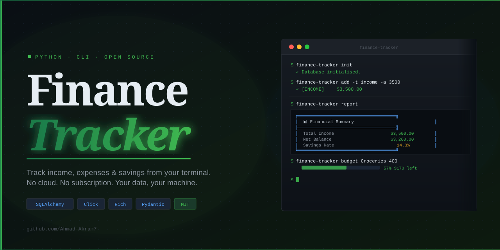
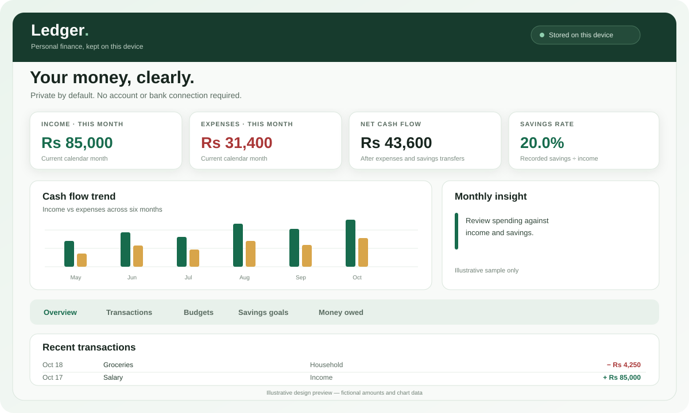

# Ledger — Personal Finance Tracker

<p align="center"></p>

<p align="center"><strong>A local-first way to understand spending, savings, and money owed.</strong><br>No account, bank connection, paid API, or backend is required for the browser app.</p>

<p align="center">
<a href="https://github.com/Ahmad-Akram7/FINANCE-TRACKER/actions/workflows/browser-checks.yml"></a>
<a href="https://github.com/Ahmad-Akram7/FINANCE-TRACKER/actions/workflows/pages.yml"></a>
<a href="LICENSE"></a>
</p>

## Browser app preview

This is an **illustrative UI preview**, not a live screenshot or proof that a deployment is healthy.

<p align="center"></p>

## Features

- **Responsive dashboard:** persistent desktop sidebar, mobile bottom navigation, compact metric cards, and a quick-add dialog.
- **Reports & charts:** interactive six-month cash-flow trend, spending donut chart, category drill-down, and six- or twelve-month income/expense comparison.
- **Transactions:** record income, expenses, and savings transfers; search/filter; delete with confirmation.
- **Budgets and goals:** category spending limits and savings target progress.
- **Money owed (khata):** running balances by person, repayments, and editable 2–3-person splits.
- **CSV:** import and export transaction records.
- **JSON backup:** export/restore transactions, budgets, goals, khata entries, people, and currency preference.
- **Responsive themes:** light/dark mode and mobile-friendly layout.

## Two separate interfaces

| Interface | Best for | Data location |
|---|---|---|
| Browser app (`site/`) | Visual dashboard, budgets, goals, CSV, khata | IndexedDB + localStorage |
| Android APK | Bundled mobile interface | Android WebView local storage |
| Python CLI (`finance_tracker/`) | Terminal workflows, filtering, reports, CSV export | Local SQLite database |

**They do not sync.** Browser records are not available in the Android app or CLI database and vice versa.

## Run the browser app locally

Open `site/index.html` in a current browser. Serving it over localhost or HTTPS is generally more reliable for browser storage than opening a local file directly.

```powershell
# From the repository root
python -m http.server 8000
```

Then visit http://localhost:8000/site/ . Add a test transaction, reload, and confirm it persists before relying on the app.

## Deploy

### GitHub Pages

The `.github/workflows/pages.yml` workflow publishes the `site/` directory to GitHub Pages on qualifying pushes to `main`. Set repository Pages source to **GitHub Actions**.

### Cloudflare Pages — manual Wrangler deployment

Cloudflare deployment is independent of GitHub Pages. To deploy from a local clone:

```powershell
Set-Location "D:\Professional\Finance Tracker\FINANCE-TRACKER"
git pull origin main
npx.cmd wrangler@latest pages deploy site --project-name finance-tracker
```

Use your own clone path if different. `npx.cmd` avoids the PowerShell script-policy issue that can block `npx.ps1`. This does not update GitHub Pages.

## Android APK

The [Android APK workflow](.github/workflows/android-apk-release.yml) wraps the static app with Capacitor, builds an installable APK, and attaches it to a GitHub Release.

- [Download releases](https://github.com/Ahmad-Akram7/FINANCE-TRACKER/releases)
- See [Android installation and data-safety notes](Docs/ANDROID-APK.md).

The first APK is debug-signed for testing. App data is separate from the browser version, is not encrypted at rest by this app, and does not sync to the CLI or other devices. Export JSON backups regularly.

## Run the Python CLI

Python 3.9+:

```powershell
python -m venv .venv
.\.venv\Scripts\Activate.ps1
python -m pip install -r requirements_finance.txt
python -m pip install -e .
finance-tracker --help
```

See [the CLI guide](FINANCE_README.md).

## Repository map

```text
.
├── site/                       # Static browser app and deployable assets
├── finance_tracker/            # Installable Python CLI package
├── test_core.py                # Core Python tests
├── requirements_finance.txt
├── setup.py
├── Docs/                       # Audit, research, feature matrix, visuals
└── .github/workflows/          # Validation, Pages deployment, Android release
```

Root-level Python modules such as `cli.py`, `core.py`, and `models.py` are compatibility shims for older imports and scripts. They are intentionally retained to avoid breaking existing usage.

## Checks

```powershell
node --check site/assets/js/app.js
python -m pip install -e .
python -m pytest -q
```

CI runs JavaScript syntax/static checks and Python tests. These do **not** replace browser end-to-end testing. See [the product audit](Docs/PRODUCT_AUDIT.md) for the release checklist.

## Troubleshooting

### Transactions do not save

- Check the storage status in the header.
- Open DevTools → Console and inspect the first relevant red error; a layout/unstyled-content warning alone does not prove storage failed.
- If the error says the database is blocked, close duplicate Ledger tabs and reload.
- Do not clear site data or reset IndexedDB if you need to preserve records.
- Export a JSON backup whenever storage works.

### The live URL does not show the latest code

Confirm which host you are testing. GitHub Pages and Cloudflare Pages are separate deployments. A successful GitHub Pages workflow does not confirm that Cloudflare was updated; deploy `site/` to the intended host.

### JSON restore fails

Use a Ledger-generated JSON file and preserve the original. Transactions are stored in IndexedDB while settings/khata are in localStorage, so a restore cannot be atomic across both storage systems.

## Privacy and data safety

Browser transactions use IndexedDB; budgets, goals, khata entries, people, and preferences use localStorage. The CLI uses separate SQLite storage. This application does **not** provide encryption at rest, bank integration, login, or multi-device sync. Currency formatting does not convert currencies. Do not store passwords or full account numbers. Keep backups in a secure location.

## Documentation and visuals

- [Product and implementation audit](Docs/PRODUCT_AUDIT.md)
- [Product research and scope](Docs/finance-manager-research.md)
- [Feature matrix](Docs/feature-matrix.csv)
- [Architecture diagram](Docs/architecture.svg)
- [Illustrative browser preview](Docs/browser-preview.svg)
- [CLI terminal preview](Docs/preview.svg)
- [Documentation index](Docs/README.md)

## License

MIT — see [LICENSE](LICENSE).
